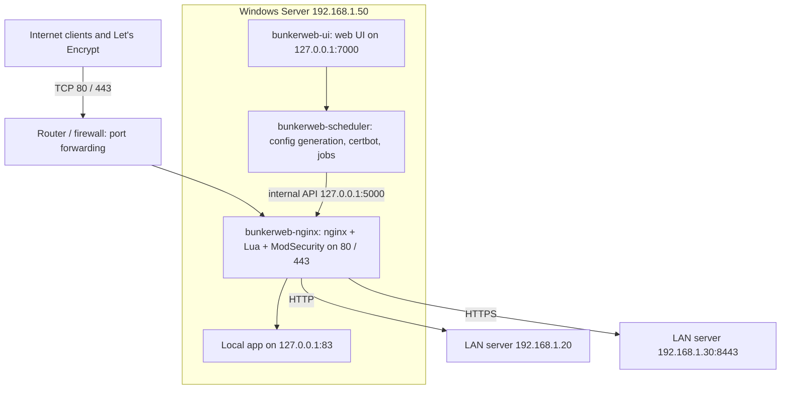

# BunkerWeb for Windows Server (native)

Run [BunkerWeb](https://github.com/bunkerity/bunkerweb) (reverse proxy + WAF + Let's Encrypt manager) **natively on Windows Server**
as Windows services: no containers, no VMs, no WSL. This repository builds the Windows installer from the unmodified upstream
sources, and this README is the operator guide for installing and running it.

| Item | Version used in this guide |
|---|---|
| Host OS | Windows Server 2019 / 2022 / 2025, x64, Desktop Experience or Core |
| BunkerWeb | 1.6.17, built natively for Windows by this repository (`windows/`, GitHub Actions) |
| Runtime | nginx with OpenResty modules, LuaJIT, ModSecurity v3 + OWASP CRS, CPython 3.14, all bundled |
| Services | Four Windows services (WinSW), no containers, no VMs, no WSL |
| Certificates | Let's Encrypt, **HTTP-01** challenge (DNS records are maintained by hand) |
| Configuration | Configuration as code (`variables.env` in git); the web UI is optional |

> [!WARNING]
> **Unofficial and work in progress.** BunkerWeb has no official Windows support. This installer is built from the unmodified
> upstream sources plus the Windows port in [`windows/`](windows/README.md). The CI pipeline is designed to install every
> build on a clean Windows Server 2022 runner and proxy traffic through it before a release is published, but the port is
> young: check the [project status](#project-status) for what has been verified. Test on a non-critical server first and keep
> your previous setup ready for rollback. Do not report problems with this port to Bunkerity.

---

## About this project

### Goal

BunkerWeb is only supported on Linux (packages) and in containers. The target environment here is a Windows Server where
container runtimes, VMs and WSL are not an option, and which has to:

- act as **reverse proxy** for many HTTP(S) backends, some on the same server and some on other servers in the LAN;
- terminate TLS with **Let's Encrypt certificates that it obtains and renews itself**, using the **HTTP-01** challenge, because
  public DNS records cannot be automated and are created by hand;
- be configured **as code** (`variables.env` and snippets in git, applied by a script). The web UI is optional and mostly
  used for monitoring.

So this project makes BunkerWeb run natively on Windows. The result is an installer that installs and starts everything
as services.

### How it is done

1. [`bunkerweb/`](bunkerweb) is the upstream repository as a git submodule, pinned to a release tag. **It is never modified.**
2. On every CI build the sources are copied and a **Windows port** is applied to the copy: anchored text replacements, a few
   shim layers (Lua and Python) and a Windows service runner. The Linux layout is mirrored below a single root, `C:\bunkerweb\`
   (`C:\bunkerweb\etc\bunkerweb`, `C:\bunkerweb\usr\share\bunkerweb`, ...); BunkerWeb's absolute paths are rewritten at build time
   to point there. Nothing is installed anywhere else on the drive.
3. The native parts (nginx with all modules linked in statically, ModSecurity, LuaJIT, Lua C modules) are compiled for Windows.
   The Python parts run on a bundled CPython.
4. [GitHub Actions](.github/workflows/bunkerweb-windows.yml) assembles an Inno Setup installer, **installs it on a clean runner,
   proxies a request through it** (smoke test) and only then publishes a release.

The engineering details are in [`windows/README.md`](windows/README.md). Contributors and coding agents should read
[`AGENTS.md`](AGENTS.md) first.

### Repository layout

| Path | Content |
|---|---|
| `README.md` | This operator guide: install, reverse proxy, Let's Encrypt, config as code, operations |
| `AGENTS.md` | Orientation for contributors and coding agents: constraints, workflow, pitfalls, status |
| `bunkerweb/` | Upstream BunkerWeb, git submodule (**read-only**) |
| `windows/` | The Windows port: build scripts, overlay files, service definitions, installer script, engineering README |
| `.github/workflows/bunkerweb-windows.yml` | Build, installer, smoke test and release pipeline |
| `.github/actions/prepare-src/` | Composite action: copies `bunkerweb/src` to `build/src` and applies the port |

Two things that are **not** in this repository: the operator's *configuration repository* (`variables.env` with the real
hostnames and backends, section 6), which every installation keeps on its own; and, for the Karlshuld fire brigade, the
older nginx + win-acme setup that this replaces (section 4).

### Non-goals

- Changing BunkerWeb itself, or maintaining a fork of it. Everything Windows-specific lives in `windows/` and is applied at build time.
- Official support by Bunkerity, high availability or clustering, HTTP/3, very high traffic (see [section 13](#13-limitations-of-the-windows-port)).
- A local build workflow. CI on `windows-2022` is the reference build and the only test harness.

### Project status

Milestones, in order:

1. **Green CI pipeline**: every job (modsecurity, native, python, package, smoke-test) passes on `windows-2022`.
2. **First release** `v1.6.17`, published automatically once the smoke test passes (a failing smoke test only produces the draft `v1.6.17-RC`).
3. **Trial on a non-critical server**: install, Let's Encrypt *staging* end to end, a few real backends, reboot and upgrade tests.
4. **Production cutover** following [section 4](#4-migrating-from-the-existing-nginx--win-acme-setup), with rollback ready.
5. **Routine upgrades** to new BunkerWeb releases ([section 11.5](#115-upgrading-bunkerweb)).

The up-to-date state, with known failures and next steps, is kept in [`AGENTS.md`](AGENTS.md#current-state). Check the
*Actions* tab and the *Releases* page for the latest build: **no installer has been verified on a real server yet.**

---

## Table of contents

0. [About this project](#about-this-project)
1. [Architecture](#1-architecture)
2. [Prerequisites and planning worksheet](#2-prerequisites-and-planning-worksheet)
3. [Getting the installer](#3-getting-the-installer)
4. [Migrating from the existing nginx / win-acme setup](#4-migrating-from-the-existing-nginx--win-acme-setup)
5. [Installation](#5-installation)
6. [Configuration as code](#6-configuration-as-code)
7. [Backends: same server and LAN](#7-backends-same-server-and-lan)
8. [Let's Encrypt with HTTP-01](#8-lets-encrypt-with-http-01)
9. [Web UI](#9-web-ui)
10. [Security tuning](#10-security-tuning)
11. [Operations](#11-operations)
12. [Troubleshooting](#12-troubleshooting)
13. [Limitations of the Windows port](#13-limitations-of-the-windows-port)
14. [Go-live checklist](#14-go-live-checklist)
15. [References](#15-references)

---

## 1. Architecture



BunkerWeb runs exactly as in its Linux integration, but as Windows services:

| Windows service | Start type | Linux equivalent | Purpose |
|---|---|---|---|
| `bunkerweb-nginx` | Automatic | `bunkerweb` | nginx (reverse proxy, WAF, TLS termination) |
| `bunkerweb-scheduler` | Automatic (delayed) | `bunkerweb-scheduler` | Reads `variables.env`, generates the nginx config, runs jobs (Let's Encrypt, blacklists, backups ...) |
| `bunkerweb-ui` | Automatic (delayed), or Disabled | `bunkerweb-ui` | Web UI |
| `bunkerweb-api` | Manual | `bunkerweb-api` | Optional REST API; not needed for this setup |

Ports:

| Port (default) | Bound to | Setting | Used by |
|---|---|---|---|
| 80/tcp | all interfaces | `HTTP_PORT` (`variables.env`) | Public HTTP. Let's Encrypt's HTTP-01 challenge always arrives on public port 80 (see below) |
| 443/tcp | all interfaces | `HTTPS_PORT` (`variables.env`) | Public HTTPS |
| 5000/tcp | `API_LISTEN_IP`, 127.0.0.1 | `API_HTTP_PORT` (`variables.env`) | Internal API (scheduler → nginx: reloads, Let's Encrypt tokens) |
| 6000/tcp | 127.0.0.1 | `HEALTHCHECK_PORT` (`variables.env`) | nginx health check (`/healthz`) |
| 7000/tcp | 127.0.0.1 | port of `UI_HOST` (`variables.env`) | Web UI |
| 8888/tcp | 127.0.0.1 | `LISTEN_PORT` (`api.env`) | REST API service (only when `bunkerweb-api` is started) |

All of these can be changed in `variables.env`; apply with `bwctl restart` (section 6.5) and, for `HTTP_PORT`/`HTTPS_PORT`,
re-sync the firewall rule with `bwctl firewall` (it opens exactly the configured two ports; the installer does the same).

- The web UI port is the port in `UI_HOST` (default `http://127.0.0.1:7000`): `UI_HOST=http://127.0.0.1:7100` makes the UI
  service listen on 7100 *and* makes BunkerWeb proxy to it. An explicit `UI_LISTEN_PORT`/`LISTEN_PORT` in `ui.env` takes
  precedence for the listener, in which case `UI_HOST` must be changed to match.
- If `HTTP_PORT` is not 80, Let's Encrypt (HTTP-01) still connects to port 80 of the public IP: forward public 80 to
  `HTTP_PORT` on your router (and public 443 to `HTTPS_PORT`).

> Local backends must **not** use the ports above. If one does, move the backend, or change the port in `variables.env`.

Everything lives below one root folder, `C:\bunkerweb\`, which mirrors the Linux layout. BunkerWeb's own absolute paths such as
`/etc/bunkerweb` are rewritten at build time to `/bunkerweb/etc/bunkerweb`, which Windows resolves to `C:\bunkerweb\etc\bunkerweb`.

> **Paths you write yourself** (in `variables.env`, custom configs, plugins, scripts) must use `C:/bunkerweb/...` or
> `/bunkerweb/...`. A plain `/etc/...` or `/var/...` would point to `C:\etc` or `C:\var`, which BunkerWeb does not use.
> Only BunkerWeb's built-in defaults are rewritten.

| Path | Content | On upgrade / uninstall |
|---|---|---|
| `C:\bunkerweb\usr\share\bunkerweb\` | Program files, bundled Python | Replaced / removed |
| `C:\bunkerweb\usr\sbin\`, `C:\bunkerweb\usr\bin\` | `nginx.exe` + DLLs; tools: `bwctl`, `bwcli`, `openssl`, `sqlite3`, busybox `sh` | Replaced / removed |
| `C:\bunkerweb\etc\bunkerweb\` | **Configuration**: `variables.env`, `ui.env`, `scheduler.env`, `api.env`, `configs\`, `plugins\` | **Kept** |
| `C:\bunkerweb\etc\nginx\` | Generated nginx configuration (do not edit; it is regenerated) | Kept |
| `C:\bunkerweb\var\lib\bunkerweb\` | **Database** `db.sqlite3`, UI secrets, backups | **Kept** |
| `C:\bunkerweb\var\cache\bunkerweb\` | Job cache, **Let's Encrypt account and certificates** | **Kept** |
| `C:\bunkerweb\var\log\bunkerweb\` | `access.log`, `error.log`, `scheduler.log`, `ui.log`, `letsencrypt\`, `service\` | Kept |

`C:\bunkerweb\etc\bunkerweb` and `C:\bunkerweb\var\lib\bunkerweb` are restricted to *Administrators* and *SYSTEM* (they contain secrets).
Edit files there from an **elevated** PowerShell or editor.

---

## 2. Prerequisites and planning worksheet

### 2.1 Requirements

- Windows Server 2019 (build 17763) or newer, x64, with the `C:` drive. The installation path (`C:\bunkerweb`) is fixed.
- 2 vCPU, 4 GB RAM and 5 GB of free disk space are comfortable for a few dozen sites.
- Administrator rights.
- A static LAN IP for the server.
- The public IP, or a router port-forward, for **80/tcp and 443/tcp** to this server.
- Access to your DNS provider's web interface, to create records by hand.
- Outbound HTTPS from the server for Let's Encrypt, blocklist updates, CRS updates and BunkerNet (if enabled).
- The server's clock must be correct. The Windows Time service is enough.
- Optional: Git for Windows, for configuration as code (section 6).
- Optional: OpenSSH Server, to tunnel to the web UI (section 9).

### 2.2 Worksheet (example values used throughout this guide)

| Item | Example | Your value |
|---|---|---|
| Public IPv4 | `203.0.113.10` | |
| BunkerWeb server (this Windows Server) | `192.168.1.50` | |
| Internal DNS resolver | `192.168.1.1` | |
| Let's Encrypt contact e-mail | `it@example.de` | |
| Service on the **same** server | `app.example.de` → `http://127.0.0.1:83` | |
| Service on a **LAN** server (HTTP) | `cloud.example.de` → `http://192.168.1.20:80` | |
| Service on a **LAN** server (HTTPS) | `secure.example.de` → `https://192.168.1.30:8443` | |
| Web UI hostname (optional, section 9) | `bw.example.de` | |

---

## 3. Getting the installer

The installer is produced by the GitHub Actions workflow
[`.github/workflows/bunkerweb-windows.yml`](.github/workflows/bunkerweb-windows.yml) in this repository:

- **Releases** (recommended): the release is named after the BunkerWeb version it contains (tag `v1.6.17`) and carries
  `bunkerweb-1.6.17-win1-x64-setup.exe` and `SHA256SUMS.txt` on the repository's *Releases* page. A newer build of the same
  BunkerWeb version replaces it. A release is only created when the automated smoke test (install → proxy request →
  reload → restart → uninstall) has passed; a failed smoke test only yields a *draft* `-RC` release (visible to maintainers
  only), which must not be used. *(No release exists until the pipeline is green, see [project status](#project-status).)*
- **CI builds**: *Actions* → *BunkerWeb for Windows* → a successful run → artifact `installer`. To build on demand, use
  *Run workflow* (`workflow_dispatch`).

Verify the download on the server:

```powershell
cd $env:USERPROFILE\Downloads
Get-FileHash .\bunkerweb-1.6.17-win1-x64-setup.exe -Algorithm SHA256   # compare with SHA256SUMS.txt
Unblock-File .\bunkerweb-1.6.17-win1-x64-setup.exe                      # remove the "downloaded from the internet" mark
```

---

## 4. Migrating from the existing nginx / win-acme setup

The server currently runs nginx (`C:\nginx`, Windows service `nginx` via NSSM) on ports 80/443. It also runs win-acme
(DNS-01) for certificates. Only one program can own ports 80 and 443, so the old setup has to be stopped
before BunkerWeb starts. Leave it **installed but disabled**, so you can roll back within a minute.

> This section is specific to the Feuerwehr Karlshuld server (the example hostname and backend below are real). On a fresh
> server, skip it and go to [section 5](#5-installation). If you migrate from another web server, adapt the service names
> in 4.2 and 4.3.

### 4.1 Before the cutover

1. Write the new `variables.env` (section 6) with the same hostnames and backends as the old vhosts.
   For example, the old vhost `app.example.com → 127.0.0.1:83` becomes:

   ```ini
   SERVER_NAME=app.example.com
   app.example.com_USE_REVERSE_PROXY=yes
   app.example.com_REVERSE_PROXY_URL=/
   app.example.com_REVERSE_PROXY_HOST=http://127.0.0.1:83
   ```

2. **Prove that port 80 is reachable from the internet.** The old setup used DNS-01, so this has never been tested.
   Use a phone on mobile data, or any external host:
   `http://app.example.com/` must reach the old nginx. A timeout means the router forward or the firewall is missing.
   Fix this first (section 8.2).
3. Run the DNS checks from section 8.3 (no stray AAAA records, CAA allows Let's Encrypt).

### 4.2 Cutover (short downtime)

From an elevated PowerShell:

```powershell
# 1. stop and disable the old nginx (NSSM service)
Stop-Service nginx
Set-Service nginx -StartupType Disabled

# 2. disable the win-acme renewal task (it would fail and log errors from now on)
Get-ScheduledTask -TaskName 'win-acme*' | Disable-ScheduledTask

# 3. ports 80/443 must be free now
Get-NetTCPConnection -State Listen -LocalPort 80, 443 -ErrorAction SilentlyContinue
```

The last command must print nothing. If something still listens, see [12.2](#122-port-80443-already-in-use).
Then install BunkerWeb (section 5) and apply the configuration (section 6).

> **Staging or production?** If you proved in 4.1 that port 80 and DNS are correct, you can set
> `USE_LETS_ENCRYPT_STAGING=no` right away. Visitors then see a valid certificate within a minute or two of the cutover.
> If you are unsure, start with staging (browser warnings until you switch) as described in section 8.

### 4.3 Rollback

```powershell
foreach ($s in 'bunkerweb-ui', 'bunkerweb-scheduler', 'bunkerweb-nginx') { Stop-Service $s; Set-Service $s -StartupType Disabled }
Set-Service nginx -StartupType Automatic; Start-Service nginx
Get-ScheduledTask -TaskName 'win-acme*' | Enable-ScheduledTask
```

To return to BunkerWeb later, set the three services back to *Automatic* (`Set-Service ... -StartupType Automatic`), stop
`nginx`, and start them in the order nginx, scheduler, ui.

Remove the old setup (`C:\nginx`, NSSM service, win-acme) only after BunkerWeb has run without problems for a few weeks and has
renewed at least one certificate.

---

## 5. Installation

### 5.1 Interactive

Run the setup as Administrator. The wizard offers three tasks, all selected by default:

| Task | Effect |
|---|---|
| Start the BunkerWeb services after installation | Starts nginx, scheduler (and UI) at the end |
| Enable the web UI service | Sets `bunkerweb-ui` to Automatic. Without it the UI service is Disabled |
| Allow inbound HTTP/HTTPS in Windows Firewall | Creates the rule group **BunkerWeb** (TCP `HTTP_PORT` and `HTTPS_PORT` from an existing `variables.env`, otherwise 80 and 443; all profiles) |

The installer also adds `C:\bunkerweb\usr\bin` to the system `PATH`, so `bwctl` and `bwcli` work in **new** shells.

### 5.2 Silent / scripted

```powershell
.\bunkerweb-1.6.17-win1-x64-setup.exe /VERYSILENT /SUPPRESSMSGBOXES /NORESTART /LOG=C:\bunkerweb-setup.log /TASKS="startservices,webui,firewall"
```

Leave a task out of `/TASKS` to skip it, e.g. `/TASKS="startservices,firewall"` installs without the web UI.

> Tip: you can create `C:\bunkerweb\etc\bunkerweb\variables.env` **before** running the installer (section 6). BunkerWeb then starts
> directly with your configuration instead of the loading page. The CI smoke test installs this way.

### 5.3 First start and checks

```powershell
bwctl status
```

Expected:

```
bunkerweb-nginx        running
bunkerweb-scheduler    running
bunkerweb-ui           running
bunkerweb-api          stopped
nginx health           ok
internal api           ok
```

- `nginx health: loading` together with the note `IS_LOADING=yes` means the configuration hasn't been applied yet. This
  is normal on a fresh install without a pre-seeded `variables.env`. BunkerWeb shows a "loading" page until you apply
  your own configuration (section 6).
- On first start the installer creates default `variables.env`, `scheduler.env` and `ui.env` files in `C:\bunkerweb\etc\bunkerweb\`
  if they don't exist yet.

---

## 6. Configuration as code

### 6.1 Concept

- A git repository holds `variables.env` (global settings and all services) and `configs\` (optional nginx/ModSecurity snippets).
  This is the operator's **own configuration repository**, separate from this one: it contains real hostnames and
  backends, so it normally stays private.
- `Apply-BunkerWebConfig.ps1` (6.6) checks the files, backs up the current state, copies them to `C:\bunkerweb\etc\bunkerweb\` and runs
  `bwctl reload-scheduler`. This is the Windows equivalent of `systemctl reload bunkerweb-scheduler`.
- The scheduler regenerates the nginx configuration, requests missing certificates and reloads nginx without dropping
  connections.

> [!IMPORTANT]
> **Use one source of truth.** Services defined in `variables.env` show up in the web UI, but they are owned by the
> file: the UI can't delete or rename them, and the next apply overwrites UI edits. In this guide the
> file wins, and the UI is used for monitoring, reports and bans. If you prefer to manage services in the UI instead, keep
> only the global settings in `variables.env` and back up the database (section 11.4). Don't manage the same service in both.

### 6.2 Repository layout

```
bunkerweb-config/
├── .gitattributes
├── README.md
├── variables.env
├── Apply-BunkerWebConfig.ps1
├── Deploy-BunkerWebConfig.ps1        (optional, push from a workstation, 6.7)
└── configs/
    ├── http/.gitkeep
    ├── server-http/.gitkeep
    ├── default-server-http/.gitkeep
    ├── modsec/.gitkeep
    ├── modsec-crs/.gitkeep
    ├── crs-plugins-before/.gitkeep
    ├── crs-plugins-after/.gitkeep
    ├── stream/.gitkeep
    └── server-stream/.gitkeep
```

`.gitattributes` keeps LF line endings even though Git for Windows defaults to CRLF:

```
* text=auto eol=lf
*.ps1 text eol=crlf
```

> Never commit secrets (`ADMIN_PASSWORD`, API tokens) to `variables.env`. Credentials for the UI belong in `C:\bunkerweb\etc\bunkerweb\ui.env`,
> which is not part of the repository (section 9.1).

### 6.3 `variables.env`

Syntax rules (same as Linux):

- One `KEY=value` per line.
- **No quotes** and **no spaces around `=`**.
- Comments only on their own line, starting with `#`.
- Multi-site settings are prefixed with the service's **first** server name: `app.example.de_USE_REVERSE_PROXY=yes`.
- Save as UTF-8 **without BOM** (or plain ASCII). The apply script normalises encoding and line endings anyway.

Complete example (adapt the worksheet values):

```ini
# ======================================================================= global
HTTP_PORT=80
HTTPS_PORT=443
# internal resolver: needed for backends given by hostname
DNS_RESOLVERS=192.168.1.1
MULTISITE=yes
# nginx for Windows effectively uses one worker process
WORKER_PROCESSES=1

# internal API (scheduler -> nginx), loopback only
API_LISTEN_IP=127.0.0.1
API_HTTP_PORT=5000
# health check endpoint, loopback only
HEALTHCHECK_PORT=6000
# address of the web UI service, used by the setup wizard and the "ui" template;
# the UI service listens on the port of this URL
UI_HOST=http://127.0.0.1:7000

# unknown hostnames / direct IP access are dropped (444)
DISABLE_DEFAULT_SERVER=yes
SERVE_FILES=no

# privacy: decide consciously (both default to yes upstream)
#   BunkerNet shares blocked IPs with Bunkerity's threat-intelligence network
USE_BUNKERNET=no
SEND_ANONYMOUS_REPORT=no

# one shared CRS ruleset in memory for all services
USE_MODSECURITY_GLOBAL_CRS=yes

# ======================================================================= Let's Encrypt (HTTP-01)
# Start with staging; switch to no once the first certificate was issued (section 8)
AUTO_LETS_ENCRYPT=yes
LETS_ENCRYPT_CHALLENGE=http
EMAIL_LETS_ENCRYPT=it@example.de
USE_LETS_ENCRYPT_STAGING=yes
LETS_ENCRYPT_CLEAR_OLD_CERTS=yes

# ======================================================================= services
# space-separated, the first name of each service is its ID / prefix
SERVER_NAME=app.example.de cloud.example.de secure.example.de

# ---------- app.example.de: application on THIS server ----------
app.example.de_USE_REVERSE_PROXY=yes
app.example.de_REVERSE_PROXY_URL=/
app.example.de_REVERSE_PROXY_HOST=http://127.0.0.1:83

# ---------- cloud.example.de: LAN server over HTTP, large uploads, websockets ----------
cloud.example.de_USE_REVERSE_PROXY=yes
cloud.example.de_REVERSE_PROXY_URL=/
cloud.example.de_REVERSE_PROXY_HOST=http://192.168.1.20
cloud.example.de_REVERSE_PROXY_WS=yes
cloud.example.de_REVERSE_PROXY_READ_TIMEOUT=300s
cloud.example.de_REVERSE_PROXY_SEND_TIMEOUT=300s
cloud.example.de_MAX_CLIENT_SIZE=2048m
cloud.example.de_SECURITY_MODE=detect

# ---------- secure.example.de: LAN server that speaks HTTPS itself ----------
secure.example.de_USE_REVERSE_PROXY=yes
secure.example.de_REVERSE_PROXY_URL=/
secure.example.de_REVERSE_PROXY_HOST=https://192.168.1.30:8443
secure.example.de_REVERSE_PROXY_SSL_SNI=yes
secure.example.de_REVERSE_PROXY_SSL_SNI_NAME=secure.example.de
```

Useful reverse-proxy settings (per service, with the `<service>_` prefix):

| Setting | Use |
|---|---|
| `REVERSE_PROXY_WS=yes` | WebSocket upgrade |
| `REVERSE_PROXY_CONNECT_TIMEOUT` / `_READ_TIMEOUT` / `_SEND_TIMEOUT` | Default `60s`; raise them for slow apps or long uploads |
| `REVERSE_PROXY_CUSTOM_HOST` | Send a different `Host` header to the backend |
| `REVERSE_PROXY_HEADERS` | Extra request headers, e.g. `X-Foo bar;X-Baz qux` |
| `REVERSE_PROXY_BUFFERING=no` | Streaming / server-sent events |
| `REVERSE_PROXY_INTERCEPT_ERRORS=no` | Pass the backend's own error pages through |
| `REVERSE_PROXY_SSL_SNI` / `_SSL_SNI_NAME` | SNI towards HTTPS backends |
| `REVERSE_PROXY_SSL_VERIFY=yes` (+ `_SSL_TRUSTED_CERTIFICATE`) | Verify the backend's certificate (off by default) |
| `MAX_CLIENT_SIZE` | Upload limit, default `10m` |

**Path-based routing** to several backends uses numbered suffixes:

```ini
app.example.de_REVERSE_PROXY_URL=/
app.example.de_REVERSE_PROXY_HOST=http://127.0.0.1:83
app.example.de_REVERSE_PROXY_URL_1=/api/
app.example.de_REVERSE_PROXY_HOST_1=http://192.168.1.21:9090
```

**Several hostnames on one service**:

```ini
app.example.de_SERVER_NAME=app.example.de www.app.example.de
```

Every name of a service becomes a SAN on its certificate. With HTTP-01, each name needs a public DNS record pointing at
you. Wildcard certificates are impossible with HTTP-01.

The full settings reference is at https://docs.bunkerweb.io/latest/features/. Every setting documented there for Linux
works the same way here.

### 6.4 Custom configuration snippets

Path in the repository: `configs\<type>\[<service-id>\]<name>.conf`. These files are copied to `C:\bunkerweb\etc\bunkerweb\configs\...`.

| Type | Inserted into |
|---|---|
| `http` | nginx `http {}` |
| `server-http` | `server {}` of every service, or of one service if placed in a subfolder named after it |
| `default-server-http` | The default (catch-all) server |
| `modsec` | ModSecurity rules (after the CRS) |
| `modsec-crs` | Before the CRS (CRS tuning) |
| `crs-plugins-before` / `crs-plugins-after` | Around the CRS plugins |
| `stream` / `server-stream` | TCP/UDP stream proxy (only if stream mode is used) |

Example: remove a ModSecurity rule that gives a false positive for one service (`configs\modsec\cloud.example.de\exclusions.conf`):

```
SecRuleRemoveById 942100
```

Paths inside snippets use forward slashes and must start with `C:/bunkerweb/...` (for example `C:/bunkerweb/var/www/...`). A path
starting with a bare `/var/...` would resolve to `C:\var`, which BunkerWeb does not use.

### 6.5 What needs a reload and what needs a restart

| Change | Apply with |
|---|---|
| Services, Let's Encrypt, security settings, snippets in `configs\` | `bwctl reload-scheduler` (no downtime) |
| `HTTP_PORT`, `HTTPS_PORT`, `API_*`, `HEALTHCHECK_PORT`, the port of `UI_HOST`, `USE_REAL_IP`/`USE_PROXY_PROTOCOL` (global listen settings) | `bwctl restart` (after `HTTP_PORT`/`HTTPS_PORT`: also `bwctl firewall`) |
| `C:\bunkerweb\etc\bunkerweb\scheduler.env` | `Restart-Service bunkerweb-scheduler` |
| `C:\bunkerweb\etc\bunkerweb\ui.env` | `Restart-Service bunkerweb-ui` |

### 6.6 `Apply-BunkerWebConfig.ps1` (runs on the server)

```powershell
#Requires -RunAsAdministrator
<#
.SYNOPSIS
  Checks variables.env and configs\ from this repository, backs up the active configuration,
  installs the new one into C:\bunkerweb\etc\bunkerweb and asks BunkerWeb to apply it.
.EXAMPLE
  .\Apply-BunkerWebConfig.ps1              # reload (no downtime)
  .\Apply-BunkerWebConfig.ps1 -Restart     # after port / listen changes
  .\Apply-BunkerWebConfig.ps1 -CheckOnly   # validate only
#>
param(
    [string] $Source = $PSScriptRoot,
    [switch] $Restart,
    [switch] $CheckOnly
)
$ErrorActionPreference = 'Stop'
$Etc     = 'C:\bunkerweb\etc\bunkerweb'
$History = 'C:\bunkerweb\var\lib\bunkerweb\config-history'
$Keep    = 30
$Bwctl   = 'C:\bunkerweb\usr\bin\bwctl.cmd'

# ---- read and normalise (no BOM, LF only)
$varsPath = Join-Path $Source 'variables.env'
if (-not (Test-Path $varsPath)) { throw "$varsPath not found" }
$text  = ([IO.File]::ReadAllText($varsPath)).TrimStart([char]0xFEFF) -replace "`r", ''
$lines = $text -split "`n"

# ---- sanity checks
$errors = @(); $seen = @{}; $n = 0
foreach ($line in $lines) {
    $n++
    if ($line -match '^\s*(#|$)') { continue }
    if ($line -notmatch '^([A-Za-z0-9][A-Za-z0-9_.\-]*)=(.*)$') { $errors += "line ${n}: expected KEY=value without spaces around '=': $line"; continue }
    $key = $Matches[1]; $value = $Matches[2]
    if ($value -match '^\s*["'']') { $errors += "line ${n}: values must not be quoted: $line" }
    if ($value -match '^\s' -and $value.Trim()) { $errors += "line ${n}: value starts with a space: $line" }
    if ($seen.ContainsKey($key)) { $errors += "line ${n}: $key is already set on line $($seen[$key])" } else { $seen[$key] = $n }
}
if (-not $seen.ContainsKey('SERVER_NAME')) { $errors += 'SERVER_NAME= is missing' }
if ($errors) { $errors | ForEach-Object { Write-Host $_ -ForegroundColor Red }; throw 'variables.env rejected' }
if ($seen.ContainsKey('IS_LOADING')) { Write-Warning 'IS_LOADING is set - BunkerWeb only shows its loading page while IS_LOADING=yes' }
Write-Host "variables.env OK ($($seen.Count) settings)" -ForegroundColor Green
if ($CheckOnly) { return }

# ---- back up the active configuration
$stamp = Get-Date -Format 'yyyyMMdd-HHmmss'
$dest = Join-Path $History $stamp
New-Item -ItemType Directory -Force $dest | Out-Null
if (Test-Path "$Etc\variables.env") { Copy-Item "$Etc\variables.env" $dest }
if (Test-Path "$Etc\configs") { Copy-Item -Recurse "$Etc\configs" $dest }

# ---- install
[IO.File]::WriteAllText("$Etc\variables.env", $text.TrimEnd("`n") + "`n", [Text.UTF8Encoding]::new($false))
$configs = Join-Path $Source 'configs'
if (Test-Path $configs) {
    robocopy $configs "$Etc\configs" /MIR /XF .gitkeep /NFL /NDL /NJH /NJS /NP | Out-Null
    if ($LASTEXITCODE -ge 8) { throw "robocopy failed with exit code $LASTEXITCODE" }
}

# ---- apply
if ($Restart) { & $Bwctl restart } else { & $Bwctl reload-scheduler }
if ($LASTEXITCODE -ne 0) { throw 'BunkerWeb did not accept the apply request (see: bwctl status)' }

# ---- keep the last $Keep backups
Get-ChildItem $History -Directory | Sort-Object Name -Descending | Select-Object -Skip $Keep | Remove-Item -Recurse -Force

Write-Host "Applied (backup: $dest). Waiting 20 s for the scheduler ..." -ForegroundColor Green
Start-Sleep -Seconds 20
& $Bwctl logs scheduler -n 25
```

**Rollback:** `git revert` and apply again. In an emergency, copy a folder from `C:\bunkerweb\var\lib\bunkerweb\config-history\<timestamp>\` back
to `C:\bunkerweb\etc\bunkerweb\` and run `bwctl reload-scheduler`.

### 6.7 Getting the repository onto the server

**Option A: clone on the server** (simplest):

```powershell
# once (Git for Windows installed)
git clone https://git.example.de/it/bunkerweb-config.git C:\Admin\bunkerweb-config

# for every change
cd C:\Admin\bunkerweb-config
git pull
.\Apply-BunkerWebConfig.ps1
```

**Option B: push from a workstation** with PowerShell remoting (WinRM, domain-joined or HTTPS listener).
Save this as `Deploy-BunkerWebConfig.ps1`:

```powershell
param([string] $Server = 'bw01.lan.example.de')
$ErrorActionPreference = 'Stop'
$stage = 'C:\bunkerweb\var\lib\bunkerweb\config-stage'   # ACL-protected like the configuration itself
$s = New-PSSession -ComputerName $Server
try {
    Invoke-Command $s { param($p) Remove-Item -Recurse -Force $p -ErrorAction SilentlyContinue; New-Item -ItemType Directory $p | Out-Null } -ArgumentList $stage
    Copy-Item -ToSession $s -Recurse -Destination $stage `
        "$PSScriptRoot\variables.env", "$PSScriptRoot\configs", "$PSScriptRoot\Apply-BunkerWebConfig.ps1"
    Invoke-Command $s { param($p) & "$p\Apply-BunkerWebConfig.ps1" -Source $p } -ArgumentList $stage
} finally {
    Remove-PSSession $s
}
```

### 6.8 Day-to-day workflow

1. Edit `variables.env` / `configs\`, run `.\Apply-BunkerWebConfig.ps1 -CheckOnly` locally, then commit.
2. Deploy (6.7) and watch `bwctl logs scheduler`.
3. Test the service in a browser.
4. Push to your internal git server. This doubles as the configuration backup.

---

## 7. Backends: same server and LAN

### 7.1 Applications on the BunkerWeb server itself

Unlike a VM- or container-based setup, BunkerWeb runs on the same OS as the local apps, so **`127.0.0.1` works**:

```ini
app.example.de_REVERSE_PROXY_HOST=http://127.0.0.1:83
```

- Let local apps listen on **127.0.0.1 only** wherever possible. Then nobody can bypass the WAF by connecting to the app port
  directly.
- If an app can only listen on all interfaces, make sure Windows Firewall has **no** inbound allow rule for its port. Inbound
  traffic is blocked by default unless a rule allows it.
- IIS on the same server: move its bindings away from 80/443, e.g. to `127.0.0.1:8080`, and proxy to it. Also check that
  no http.sys URL reservation still holds port 80 (section 12.2).
- Avoid the ports BunkerWeb uses (HTTP/HTTPS, 5000, 6000, 7000, 8888 by default; see section 1).

### 7.2 Applications on other LAN servers

- Make sure the backend listens on its LAN address and allow **only the BunkerWeb server** in its firewall.
  On a Windows backend:

  ```powershell
  New-NetFirewallRule -DisplayName 'app 8080 from BunkerWeb' -Direction Inbound -Protocol TCP -LocalPort 8080 `
      -RemoteAddress 192.168.1.50 -Action Allow -Profile Any
  ```

- HTTPS backends with self-signed certificates work, because the upstream certificate isn't verified by default. Set SNI as in 6.3.
- Backends given by hostname are resolved through `DNS_RESOLVERS`. Point it at your internal DNS server.

### 7.3 Test every backend from the BunkerWeb server first

```powershell
Test-NetConnection 192.168.1.20 -Port 80
curl.exe -sv -o NUL http://127.0.0.1:83/
curl.exe -sv -o NUL http://192.168.1.20/
curl.exe -skv -o NUL https://192.168.1.30:8443/
```

If these fail, BunkerWeb returns 502/504. Fix the backend or firewall first.

### 7.4 Application-side settings

Many apps need to know they run behind a reverse proxy:

- Set the trusted proxy to `127.0.0.1` for local apps, or `192.168.1.50` for LAN apps.
- Set the public URL to `https://...`.
- Make the app honour `X-Forwarded-Proto` and `X-Forwarded-For`.

Without this you get redirect loops, wrong absolute URLs, or every user appearing to come from the proxy.
BunkerWeb sends these headers to the backend by default:

- `Host: $host`
- `X-Real-IP`
- `X-Forwarded-For`
- `X-Forwarded-Proto`
- `X-Forwarded-Host`

---

## 8. Let's Encrypt with HTTP-01

### 8.1 How it works

- The scheduler job `certbot-new` requests certificates for every service that has no certificate yet. `certbot-renew` runs
  daily and renews certificates that are close to expiry. Both run inside `bunkerweb-scheduler`. No scheduled task is needed.
- Let's Encrypt connects to `http://<hostname>/.well-known/acme-challenge/<token>` on **port 80** from several locations
  worldwide. BunkerWeb answers that path for all services before any HTTP→HTTPS redirect.
- Once a certificate exists, HTTP is redirected to HTTPS automatically (`AUTO_REDIRECT_HTTP_TO_HTTPS=yes` by default).
- Paths:
  - certificates: `C:\bunkerweb\var\cache\bunkerweb\letsencrypt\etc\live\<service>\` (also stored in the database);
  - logs: `C:\bunkerweb\var\log\bunkerweb\letsencrypt\` plus `scheduler.log`.
- Until a certificate exists, BunkerWeb serves a self-signed fallback certificate, so browsers show a warning.

### 8.2 One-time network preparation

1. On the router, forward **80/tcp and 443/tcp** from the public IP to `192.168.1.50`. Remove any older forwards of these ports
   to other machines.
2. Windows Firewall: the installer task *firewall* creates the rule group **BunkerWeb** (`HTTP_PORT`/`HTTPS_PORT`, 80 and 443 by default; `bwctl firewall` re-creates it after a port change). Check it:
   `Get-NetFirewallRule -Group BunkerWeb`.
3. Port 80 must stay reachable **from the whole internet**:
   - no geo-blocking on 80, because Let's Encrypt validates from several continents;
   - no `WHITELIST_COUNTRY` in BunkerWeb for services that need certificates.
4. If your router has no hairpin NAT (LAN clients can't reach the public IP), set up **split DNS** on the internal DNS server.
   Point the service names at `192.168.1.50` for LAN clients.

### 8.3 Per-hostname procedure (manual DNS)

For every new hostname:

1. **Create the DNS record by hand:** `app.example.de  A  203.0.113.10`, or a CNAME to a name that resolves there.
2. **Check public resolution** before touching BunkerWeb. Failed validations count against rate limits.

   ```powershell
   Resolve-DnsName app.example.de -Type A    -Server 1.1.1.1
   Resolve-DnsName app.example.de -Type AAAA -Server 1.1.1.1   # should return nothing (see pitfalls)
   Resolve-DnsName example.de     -Type CAA  -Server 1.1.1.1   # empty, or includes letsencrypt.org
   ```

3. **Check port 80 from outside** (phone on mobile data): `http://app.example.de/.well-known/acme-challenge/test` must return
   a 404 (or 403) page from BunkerWeb, **not** a timeout.
4. **Add the service** to `variables.env`: append it to `SERVER_NAME` and add the `<service>_...` settings.
5. **Apply** (section 6) and follow the logs:

   ```powershell
   bwctl logs scheduler -n 80
   Get-ChildItem C:\bunkerweb\var\cache\bunkerweb\letsencrypt\etc\live\
   Get-ChildItem C:\bunkerweb\var\log\bunkerweb\letsencrypt\ | Sort-Object LastWriteTime | Select-Object -Last 1 | Get-Content -Tail 50
   ```

6. **Check the certificate that is served.** Save this helper, e.g. in your PowerShell profile or the config repository:

   ```powershell
   function Get-ServedCertificate([string] $HostName, [string] $Address = '127.0.0.1', [int] $Port = 443) {
       $tcp = [Net.Sockets.TcpClient]::new($Address, $Port)
       try {
           $accept = [Net.Security.RemoteCertificateValidationCallback] { param($s, $c, $ch, $e) $true }
           $ssl = [Net.Security.SslStream]::new($tcp.GetStream(), $false, $accept)
           $ssl.AuthenticateAsClient($HostName)
           $cert = [Security.Cryptography.X509Certificates.X509Certificate2]::new($ssl.RemoteCertificate)
           [pscustomobject]@{
               Host     = $HostName
               Subject  = $cert.Subject
               Issuer   = $cert.Issuer
               NotAfter = $cert.NotAfter
               SAN      = ($cert.Extensions | Where-Object { $_.Oid.Value -eq '2.5.29.17' } | ForEach-Object { $_.Format($false) })
           }
       } finally { $tcp.Dispose() }
   }

   Get-ServedCertificate app.example.de
   ```

   With staging, the issuer contains `(STAGING)`. With the self-signed fallback, issuer and subject are identical.
7. **Switch to production:** set `USE_LETS_ENCRYPT_STAGING=no` and apply.
   - BunkerWeb notices that the existing certificate came from staging and requests a new one.
   - Confirm with `Get-ServedCertificate` that the issuer is now a production Let's Encrypt CA (e.g. `CN=R12, O=Let's Encrypt`).
   - If the staging certificate is still served, delete it on the *Let's Encrypt* page of the web UI and run
     `bwctl reload-scheduler`.

> Once everything works globally, you can add later hostnames directly in production if steps 2–3 pass.
> If you're unsure, use staging for that one service only: `newsvc.example.de_USE_LETS_ENCRYPT_STAGING=yes`.

### 8.4 Pitfalls

| Pitfall | Effect | Fix |
|---|---|---|
| **AAAA record** exists but IPv6 port 80 doesn't reach BunkerWeb | Let's Encrypt prefers IPv6, so validation fails | Remove the AAAA record, or forward IPv6 80/443 to the server properly |
| **CAA record** without `letsencrypt.org` | Issuance refused | Add `example.de CAA 0 issue "letsencrypt.org"` |
| Port 80 geo-blocked, or closed after the first issuance | Renewals fail silently about 30 days before expiry | Keep 80 open worldwide, permanently |
| Typo in DNS, or DNS not yet propagated | Failed validations count against rate limits | Always run the `Resolve-DnsName` checks first |
| Wildcard wanted | Impossible with HTTP-01 | List each hostname explicitly |
| No hairpin NAT | Works from outside, times out from inside | Split DNS (8.2) |
| Rate limits (e.g. 5 duplicate certificates per week, 5 failed validations per hostname per hour) | Temporarily locked out | Use staging while testing |
| Another program grabbed port 80 after a reboot (IIS, http.sys reservation, the old nginx service) | Challenge answered by the wrong server | `Get-NetTCPConnection -LocalPort 80 -State Listen`; section 12.2 |

### 8.5 Expiry monitoring

Let's Encrypt **no longer sends expiry e-mails**, and certificate lifetimes are getting shorter. Monitor expiry yourself.
`C:\Admin\Test-BunkerWebCertificates.ps1` checks the certificate served for every name in `SERVER_NAME`. It writes a warning
into the *Application* event log when a certificate expires within 14 days or is still a staging or self-signed certificate:

```powershell
param([int] $Days = 14)
$ErrorActionPreference = 'Stop'
$names = (Get-Content C:\bunkerweb\etc\bunkerweb\variables.env | Where-Object { $_ -match '^SERVER_NAME=' }) -replace '^SERVER_NAME=', '' -split '\s+' | Where-Object { $_ }
$problems = @()
foreach ($name in $names) {
    $tcp = $null
    try {
        $tcp = [Net.Sockets.TcpClient]::new('127.0.0.1', 443)
        $accept = [Net.Security.RemoteCertificateValidationCallback] { param($s, $c, $ch, $e) $true }
        $ssl = [Net.Security.SslStream]::new($tcp.GetStream(), $false, $accept)
        $ssl.AuthenticateAsClient($name)
        $cert = [Security.Cryptography.X509Certificates.X509Certificate2]::new($ssl.RemoteCertificate)
        $left = [int]($cert.NotAfter - (Get-Date)).TotalDays
        $line = '{0,-40} {1,4} days  {2}' -f $name, $left, $cert.Issuer
        Write-Output $line
        if ($left -lt $Days -or $cert.Issuer -match 'STAGING' -or $cert.Issuer -eq $cert.Subject) { $problems += $line }
    } catch {
        $problems += "${name}: $($_.Exception.Message)"
    } finally {
        if ($tcp) { $tcp.Dispose() }
    }
}
if ($problems) {
    if (-not [Diagnostics.EventLog]::SourceExists('BunkerWeb')) { New-EventLog -LogName Application -Source 'BunkerWeb' }
    Write-EventLog -LogName Application -Source 'BunkerWeb' -EventId 1001 -EntryType Warning `
        -Message ("Certificate problems:`n" + ($problems -join "`n"))
    exit 1
}
```

Schedule it daily:

```powershell
$a = New-ScheduledTaskAction -Execute 'powershell.exe' -Argument '-NoProfile -ExecutionPolicy Bypass -File C:\Admin\Test-BunkerWebCertificates.ps1'
$t = New-ScheduledTaskTrigger -Daily -At 7am
Register-ScheduledTask -TaskName 'BunkerWeb certificate check' -Action $a -Trigger $t -User 'SYSTEM' -RunLevel Highest
```

Forward event ID 1001 (source *BunkerWeb*) to your monitoring, or add an external TLS-expiry check against each public hostname
(e.g. Uptime Kuma). A certificate within 14 days of expiry means renewals are failing; renewal normally happens about 30 days
before expiry. Check port 80, DNS and the Let's Encrypt logs.

---

## 9. Web UI

### 9.1 Admin account

The UI service listens on `127.0.0.1`, on the port of `UI_HOST` (7000 by default; the examples below use 7000). There are two ways to create the first admin:

- **Wizard:** open the UI (9.2) and follow the setup wizard.
- **Configuration file (recommended):** edit `C:\bunkerweb\etc\bunkerweb\ui.env` in an elevated editor and restart the UI:

  ```ini
  ADMIN_USERNAME=admin
  # min. 8 characters with upper case, lower case, a digit and a special character
  # a bcrypt hash is also accepted here instead of the plain password
  ADMIN_PASSWORD=Change-Me-2026!
  # OVERRIDE_ADMIN_CREDS=yes   (only to reset a lost password, remove afterwards)
  LISTEN_ADDR=127.0.0.1
  FORWARDED_ALLOW_IPS=127.0.0.1,::1
  PROXY_ALLOW_IPS=127.0.0.1,::1
  LOG_LEVEL=info
  LOG_TYPES=file
  ```

  ```powershell
  Restart-Service bunkerweb-ui
  ```

The UI generates its secrets on first start: `C:\bunkerweb\var\lib\bunkerweb\.flask_secret` and `.totp_encryption_keys.json`.
Include them in backups. Without the TOTP keys, users with 2FA can't log in after a restore.

**Enable TOTP (2FA)** for every UI account (*Profile* → *Security*).

### 9.2 Accessing the UI

| Option | How | Notes |
|---|---|---|
| **A: SSH tunnel** (recommended) | Install OpenSSH Server on the server, then `ssh -L 7000:127.0.0.1:7000 admin@192.168.1.50` from the workstation and browse to `http://localhost:7000` | Nothing exposed, no certificate needed |
| **B: Browser on the server** | RDP, then `http://127.0.0.1:7000` | Server 2019 only ships Internet Explorer, which the UI does not support. Install Edge or Firefox first |
| **C: Publish through BunkerWeb** | See below | Needs a public DNS record (HTTP-01) |

OpenSSH Server for option A (allow only the admin network):

```powershell
Add-WindowsCapability -Online -Name OpenSSH.Server~~~~0.0.1.0
Set-Service sshd -StartupType Automatic; Start-Service sshd
Get-NetFirewallRule -Name OpenSSH-Server-In-TCP | Set-NetFirewallRule -RemoteAddress 192.168.1.0/24
```

Option C: add `bw.example.de` to `SERVER_NAME` and:

```ini
bw.example.de_USE_TEMPLATE=ui
bw.example.de_USE_REVERSE_PROXY=yes
bw.example.de_REVERSE_PROXY_URL=/a-long-random-secret-path
bw.example.de_REVERSE_PROXY_HOST=http://127.0.0.1:7000
```

- Use a hard-to-guess path and enable TOTP.
- A plain "allow LAN, deny all" rule on this service would also block the Let's Encrypt validation on port 80. For LAN-only
  access use option A.

### 9.3 What the UI is for in this setup

- Dashboards, reports (blocked requests), bans and unbans.
- Logs.
- Viewing the effective settings and certificates.

Services defined in `variables.env` appear locked for editing. That is expected (6.1).

If you **don't want the UI** at all:

```powershell
Stop-Service bunkerweb-ui
Set-Service bunkerweb-ui -StartupType Disabled
```

You can also leave the *webui* task unchecked in the installer.

---

## 10. Security tuning

### 10.1 Relevant defaults

| Feature | Setting (default) | Notes |
|---|---|---|
| WAF | `USE_MODSECURITY=yes`, `USE_MODSECURITY_CRS=yes` (CRS v4) | The most common cause of 403s in new apps |
| Mode | `SECURITY_MODE=block` | `detect` only logs; use it per service while onboarding |
| Bad behaviour | `USE_BAD_BEHAVIOR=yes` | US spelling. Bans IPs that cause many 4xx responses |
| Request limit | `USE_LIMIT_REQ=yes`, `LIMIT_REQ_RATE=2r/s` | Per URL; often too low for SPA/API-heavy apps |
| Methods | `ALLOWED_METHODS=GET\|POST\|HEAD\|QUERY` | WebDAV/REST apps need more |
| Body size | `MAX_CLIENT_SIZE=10m` | Raise it for upload services |
| HSTS | `STRICT_TRANSPORT_SECURITY=max-age=63072000; includeSubDomains; preload` | Browsers remember HTTPS-only for 2 years. Lower it while testing |
| DNSBL | `USE_DNSBL=yes` | Needs outbound DNS |
| BunkerNet / anonymous reports | `yes` / `yes` | Outbound data sharing; set to `no` if not wanted (6.3) |
| Antibot | `USE_ANTIBOT=no` | Can be `captcha`, `javascript`, ... per service |

### 10.2 Onboarding a new app

1. Set `<service>_SECURITY_MODE=detect` and apply.
2. Use the app normally for a few days. Check **Reports** in the UI and `bwctl logs error` for ModSecurity hits.
3. Add precise exclusions (`configs\modsec\<service>\*.conf`), raise limits, or add methods. Examples:

   ```ini
   # API-heavy app
   app.example.de_LIMIT_REQ_RATE=20r/s
   # WebDAV (e.g. Nextcloud-style)
   cloud.example.de_ALLOWED_METHODS=GET|POST|HEAD|PUT|DELETE|OPTIONS|PROPFIND|PROPPATCH|MKCOL|COPY|MOVE|LOCK|UNLOCK|REPORT
   ```

4. Switch to `SECURITY_MODE=block` (or remove the line) and apply.

### 10.3 Bans

From an elevated shell:

```powershell
bwcli bans                 # list bans
bwcli unban 198.51.100.7
```

Or use the UI. Be careful with whitelisting the LAN (`USE_WHITELIST`/`WHITELIST_IP`): whitelisted clients bypass **all**
security checks.

---

## 11. Operations

### 11.1 Service control

| Task | Command (elevated PowerShell) |
|---|---|
| Overview: services, nginx health, internal API | `bwctl status` |
| Apply `variables.env` / snippets | `bwctl reload-scheduler` |
| Reload nginx with its current configuration | `bwctl reload` |
| Test the generated nginx configuration | `bwctl test` |
| Restart everything (in dependency order) | `bwctl restart` |
| Re-create the firewall rule for `HTTP_PORT`/`HTTPS_PORT` | `bwctl firewall` |
| Restart one service | `bwctl restart ui`, or `Restart-Service bunkerweb-ui` |
| Stop everything | `Stop-Service bunkerweb-ui, bunkerweb-scheduler, bunkerweb-nginx` |
| BunkerWeb CLI (bans, plugin commands) | `bwcli ...` |

The services also appear in `services.msc` as *BunkerWeb (nginx)*, *BunkerWeb (scheduler)* and so on. They restart automatically
after a crash: 10 s, 30 s and 60 s back-off, and the failure counter resets after 1 hour.

### 11.2 Logs

| What | Where | Quick view |
|---|---|---|
| nginx access / error | `C:\bunkerweb\var\log\bunkerweb\access.log`, `error.log` | `bwctl logs access`, `bwctl logs error -n 200` |
| Scheduler (config generation, jobs) | `C:\bunkerweb\var\log\bunkerweb\scheduler.log` | `bwctl logs scheduler` |
| Web UI | `C:\bunkerweb\var\log\bunkerweb\ui.log` | `bwctl logs ui` |
| Let's Encrypt (certbot) | `C:\bunkerweb\var\log\bunkerweb\letsencrypt\` | see 8.3 |
| Service wrappers (start/stop, crashes) | `C:\bunkerweb\var\log\bunkerweb\service\bunkerweb-<name>*.log` | `bwctl logs service-nginx`, `service-scheduler`, `service-ui` |

Live view: `Get-Content C:\bunkerweb\var\log\bunkerweb\error.log -Wait -Tail 20`.

The service wrapper logs rotate by size, and certbot rotates its own logs. **nginx and the Python services do not rotate
their logs**: there is no logrotate on Windows. Rotate them with a scheduled task. `C:\Admin\Rotate-BunkerWebLogs.ps1` uses
copy-and-truncate, so the services keep running:

```powershell
$ErrorActionPreference = 'Stop'
$LogDir   = 'C:\bunkerweb\var\log\bunkerweb'
$Archive  = 'C:\bunkerweb\var\log\bunkerweb\archive'
$KeepDays = 30
New-Item -ItemType Directory -Force $Archive | Out-Null
$stamp = Get-Date -Format 'yyyyMMdd-HHmmss'
foreach ($log in Get-ChildItem $LogDir -Filter *.log -File) {
    if ($log.Length -lt 1MB) { continue }
    $copy = Join-Path $Archive "$($log.BaseName)-$stamp.log"
    Copy-Item $log.FullName $copy
    # nginx and Python keep their handles open in append mode: truncate in place
    $fs = [IO.File]::Open($log.FullName, 'Open', 'Write', 'ReadWrite, Delete')
    try { $fs.SetLength(0) } finally { $fs.Dispose() }
    Compress-Archive -Path $copy -DestinationPath "$copy.zip" -Force
    Remove-Item $copy
}
Get-ChildItem $Archive -Filter *.zip | Where-Object LastWriteTime -lt (Get-Date).AddDays(-$KeepDays) | Remove-Item -Force
```

```powershell
$a = New-ScheduledTaskAction -Execute 'powershell.exe' -Argument '-NoProfile -ExecutionPolicy Bypass -File C:\Admin\Rotate-BunkerWebLogs.ps1'
$t = New-ScheduledTaskTrigger -Daily -At 2:30am
Register-ScheduledTask -TaskName 'BunkerWeb log rotation' -Action $a -Trigger $t -User 'SYSTEM' -RunLevel Highest
```

### 11.3 Windows Updates and reboots

- All services start automatically after a reboot: nginx first, then the scheduler and UI (delayed start).
- Expect a short outage of the proxied sites while the server reboots.
- After a reboot, `bwctl status` should show *health ok* within about a minute. If it doesn't, see section 12.
- If the Windows Server itself is a VM, its hypervisor snapshots are the easiest rollback point before upgrades (11.5).

### 11.4 Backups

Back up three layers:

1. **Configuration as code:** the git repository, pushed to a server.
2. **BunkerWeb database** (settings, UI users, reports, certificate cache). The built-in backup plugin is on by default:
   `USE_BACKUP=yes`, `BACKUP_SCHEDULE=daily`, `BACKUP_ROTATION=7`, `BACKUP_DIRECTORY=/bunkerweb/var/lib/bunkerweb/backups`
   (that is `C:\bunkerweb\var\lib\bunkerweb\backups`). Manual commands:

   ```powershell
   bwcli plugin backup save
   bwcli plugin backup list
   ```

3. **Files** (with your normal server backup, e.g. Windows Server Backup or Veeam):

   | Path | Why |
   |---|---|
   | `C:\bunkerweb\etc\bunkerweb\` | Live configuration, `ui.env` (admin credentials) |
   | `C:\bunkerweb\var\lib\bunkerweb\` | Database, DB backups, `.flask_secret`, `.totp_encryption_keys.json`, config history |
   | `C:\bunkerweb\var\cache\bunkerweb\letsencrypt\` | Let's Encrypt account and certificates; avoids re-issuing everything after a restore |

   A file-level copy of `db.sqlite3` taken while the scheduler is running may be inconsistent. Restore from the backup plugin's
   dumps in `C:\bunkerweb\var\lib\bunkerweb\backups\` instead, or stop `bunkerweb-ui` and `bunkerweb-scheduler` while copying.

### 11.5 Upgrading BunkerWeb

New BunkerWeb releases need a new build of this port: move the `bunkerweb` submodule to the new tag, let CI build and test it,
and tag `v<version>-win<N>` (see [`windows/README.md`](windows/README.md)). Then, on the server:

1. Read the upstream release notes and https://docs.bunkerweb.io/latest/upgrading/.
2. Back up:

   ```powershell
   bwcli plugin backup save
   Stop-Service bunkerweb-ui, bunkerweb-scheduler
   $d = "C:\Admin\pre-upgrade-$(Get-Date -Format yyyyMMdd)"
   New-Item -ItemType Directory $d | Out-Null
   Copy-Item -Recurse C:\bunkerweb\etc\bunkerweb, C:\bunkerweb\var\lib\bunkerweb $d
   ```

   If the server is a VM, take a snapshot too.
3. Run the new installer with the same tasks as before (interactively, or silently as in 5.2). It stops the services, replaces
   the program files, keeps configuration and data, and starts the services again. The scheduler migrates the database
   schema on its first start.
4. Check `bwctl status`, every site, and `Get-ServedCertificate` for each hostname.

**Rollback:** run the previous installer and restore `C:\bunkerweb\var\lib\bunkerweb\db.sqlite3` from step 2. Database migrations
are one-way.

### 11.6 Uninstalling

*Settings → Apps → BunkerWeb for Windows → Uninstall* (or `C:\ProgramData\BunkerWeb\uninstall\unins000.exe`). The uninstaller:

- removes the services, the program files, the firewall rule group and the `PATH` entry;
- **keeps** `C:\bunkerweb\etc\bunkerweb`, `C:\bunkerweb\var\lib\bunkerweb`, `C:\bunkerweb\var\cache\bunkerweb` and `C:\bunkerweb\var\log\bunkerweb`. Delete them by hand
  if you really want to remove everything.

---

## 12. Troubleshooting

### 12.1 First steps

```powershell
bwctl status
bwctl logs service-nginx -n 50       # why did a service not start?
bwctl logs scheduler -n 100          # configuration generation / Let's Encrypt
bwctl logs error -n 100              # nginx / ModSecurity / Lua errors
bwctl test                           # syntax check of the generated nginx configuration
Get-WinEvent -LogName System -MaxEvents 30 | Where-Object Message -match 'BunkerWeb'   # service control manager
```

### 12.2 Port 80/443 already in use

```powershell
Get-NetTCPConnection -State Listen -LocalPort 80, 443 | Select-Object LocalAddress, LocalPort, OwningProcess,
    @{ n = 'Process'; e = { (Get-Process -Id $_.OwningProcess).Path } }
```

| Owner | Fix |
|---|---|
| `C:\nginx\nginx.exe` | The old nginx service still runs: `Stop-Service nginx; Set-Service nginx -StartupType Disabled` |
| PID 4 (*System*) | http.sys: IIS (`W3SVC`), WSUS, SSRS or a URL reservation. Check `netsh http show servicestate` and `netsh http show urlacl`; stop or rebind the owner |
| Something else | Move or stop it |

The internal ports can collide too: some ranges are reserved by Hyper-V/WinNAT
(`netsh interface ipv4 show excludedportrange protocol=tcp`). If 5000, 6000 or 7000 falls into such a range, change
`API_HTTP_PORT`, `HEALTHCHECK_PORT` or the port of `UI_HOST` in variables.env (section 1). Moving `HTTP_PORT`/`HTTPS_PORT`
away from 80/443 works the same way, but remember the router forward and `bwctl firewall`.

### 12.3 Symptom table

| Symptom | Likely cause | Check / fix |
|---|---|---|
| Every site shows the BunkerWeb **loading page** | `IS_LOADING=yes` still in `variables.env`, or the configuration was never applied | Remove the line; `bwctl reload-scheduler`; `bwctl logs scheduler` |
| A service stops right after starting | Configuration error, port conflict, damaged installation | `bwctl logs service-<name>`; 12.2; re-run the installer (repair) |
| Changes in `variables.env` have no effect | Not applied, or the scheduler rejected the configuration | `bwctl reload-scheduler`; scheduler log; `-CheckOnly` of the apply script |
| `bwctl reload-scheduler`: "scheduler is not running" | Scheduler service stopped or crashed | `Start-Service bunkerweb-scheduler`; `bwctl logs service-scheduler` |
| **502 Bad Gateway** | Backend unreachable, wrong port, firewall | Tests from 7.3; backend firewall; `REVERSE_PROXY_HOST` |
| **504 Gateway Timeout** | Slow backend | Raise `REVERSE_PROXY_READ_TIMEOUT` / `_SEND_TIMEOUT` |
| **403 Forbidden** in normal use | ModSecurity CRS false positive | `bwctl logs error` / UI reports → `SECURITY_MODE=detect` → exclusion in `configs\modsec\<svc>\` |
| **405 Method Not Allowed** | Method not in `ALLOWED_METHODS` | Add it per service |
| **413 Request Entity Too Large** | Upload larger than `MAX_CLIENT_SIZE` | Raise it per service (and in the backend) |
| **429 Too Many Requests** | `LIMIT_REQ_RATE` too low | Raise it per service |
| A client is suddenly blocked everywhere | Bad-behaviour ban | `bwcli bans` / `bwcli unban <ip>` |
| WebSockets fail | WS upgrade disabled | `<svc>_REVERSE_PROXY_WS=yes` |
| Redirect loop / mixed content | App doesn't trust `X-Forwarded-Proto` | Configure the trusted proxy and public URL in the app (7.4) |
| Let's Encrypt fails: timeout / connection | Port 80 not forwarded or blocked, geo-block, AAAA | 8.2 / 8.4; test from outside |
| Let's Encrypt fails: NXDOMAIN / unauthorized | DNS missing or wrong | `Resolve-DnsName ... -Server 1.1.1.1` |
| Let's Encrypt fails: CAA | CAA excludes Let's Encrypt | Add the `letsencrypt.org` CAA record |
| Browser warns "untrusted" | Still a staging or self-signed fallback certificate | `Get-ServedCertificate`; `USE_LETS_ENCRYPT_STAGING=no` |
| Access via IP or an unknown name is dropped | `DISABLE_DEFAULT_SERVER=yes` | Intended; use the hostnames |
| Works from outside, not from the LAN | No hairpin NAT | Split DNS → 192.168.1.50 |
| Values look odd / settings ignored | Quotes, spaces or BOM in `variables.env` | Run the apply script; it rejects and normalises such lines |
| Setting locked in the UI | Service owned by `variables.env` | Edit it in git (6.1) |
| Locked out of the UI | Password unknown or TOTP keys lost | Set `ADMIN_PASSWORD` + `OVERRIDE_ADMIN_CREDS=yes` in `ui.env`, restart the UI, then remove the override; restore `.totp_encryption_keys.json` |
| High CPU in `MsMpEng.exe` under load | Defender scanning temp files of nginx | Optionally exclude `C:\bunkerweb\var\tmp\bunkerweb` and `C:\bunkerweb\var\cache\bunkerweb` (`Add-MpPreference -ExclusionPath ...`). Weigh the security trade-off |

### 12.4 Collecting information for a bug report (Windows port)

```powershell
$d = "C:\Admin\bw-diag-$(Get-Date -Format yyyyMMdd-HHmmss)"
New-Item -ItemType Directory $d | Out-Null
bwctl status > "$d\status.txt"
Copy-Item -Recurse C:\bunkerweb\var\log\bunkerweb, C:\bunkerweb\etc\nginx $d
Copy-Item C:\bunkerweb\usr\share\bunkerweb\windows\BUILDINFO $d
Compress-Archive $d "$d.zip"
```

Remove secrets (tokens, passwords in `ui.env` or `variables.env`) before sharing anything. Open issues in **this** repository,
not at bunkerity/bunkerweb.

---

## 13. Limitations of the Windows port

| Limitation | Impact |
|---|---|
| One nginx worker, `select()` event model (nginx for Windows) | Fine for typical on-premise traffic; not for high-traffic sites. Keep `WORKER_PROCESSES=1` and the default `WORKER_CONNECTIONS` |
| No HTTP/3 (QUIC), no `reuseport` | The port switches the HTTP/3 blocks off whatever `HTTP3` says (default `no`); the `$http3` limit zone never applies |
| Paths fixed to `C:\bunkerweb` | The installer can't relocate BunkerWeb |
| Lua libraries luasocket, luasec and `lua-resty-signal` are not included | Not used by BunkerWeb's core features. Third-party plugins that need them won't work |
| External plugins that run Linux binaries or shell scripts | Only work if busybox provides the tool |
| Some upstream features are untested on Windows (e.g. Redis clustering, CrowdSec bouncer, PRO plugins) | Test before use |
| Unofficial build, not covered by Bunkerity support | Keep the rollback path (4.3) |

**Licence:** BunkerWeb is licensed under the AGPLv3. This port and its installer are a modified version under the same licence.
The complete corresponding source is this repository (including `windows/` and the `bunkerweb` submodule commit) at the tag
the installer was built from. Keep the repository public, or otherwise provide the source, if you distribute the installer.

---

## 14. Go-live checklist

- [ ] Installer downloaded from a release whose smoke test passed; SHA-256 verified.
- [ ] Old nginx service and win-acme task **disabled**, not removed (rollback path 4.3 tested once).
- [ ] `bwctl status`: nginx, scheduler (and UI) running, health `ok`, no `IS_LOADING`.
- [ ] Server rebooted once: everything comes back on its own.
- [ ] Config repository with `.gitattributes` and `Apply-BunkerWebConfig.ps1`; the apply process tested end to end.
- [ ] Router forwards 80/443 to the server; port 80 reachable worldwide.
- [ ] For each hostname: A record set, no stray AAAA, CAA OK.
- [ ] All certificates are **production** (`Get-ServedCertificate` issuer check), not staging or self-signed.
- [ ] Each backend reachable from the server; LAN backends firewalled to accept only 192.168.1.50; local apps on 127.0.0.1.
- [ ] Each app configured for the reverse proxy (trusted proxy, public URL).
- [ ] Each app moved from `SECURITY_MODE=detect` to `block`.
- [ ] Split DNS in place if there is no hairpin NAT.
- [ ] UI admin has a strong password and TOTP; UI not exposed (or option C with a secret path and TOTP).
- [ ] Decision on `USE_BUNKERNET` / `SEND_ANONYMOUS_REPORT` documented.
- [ ] Backups: git pushed, `USE_BACKUP=yes`, `C:\bunkerweb\etc\bunkerweb`, `C:\bunkerweb\var\lib\bunkerweb` and `C:\bunkerweb\var\cache\bunkerweb\letsencrypt` in the server backup.
- [ ] Scheduled tasks: certificate check (8.5) and log rotation (11.2).
- [ ] This document updated with your real values.

---

## 15. References

- Windows port (architecture, build, limitations): [`windows/README.md`](windows/README.md)
- BunkerWeb repository: https://github.com/bunkerity/bunkerweb
- BunkerWeb documentation: https://docs.bunkerweb.io/latest/
- Features and settings reference: https://docs.bunkerweb.io/latest/features/
- Advanced usage (custom configs, etc.): https://docs.bunkerweb.io/latest/advanced/
- Web UI: https://docs.bunkerweb.io/latest/web-ui/
- Upgrading: https://docs.bunkerweb.io/latest/upgrading/
- nginx for Windows (known issues): https://nginx.org/en/docs/windows.html
- WinSW (service wrapper): https://github.com/winsw/winsw
- busybox-w32: https://frippery.org/busybox/
- Let's Encrypt challenge types: https://letsencrypt.org/docs/challenge-types/
- Let's Encrypt rate limits: https://letsencrypt.org/docs/rate-limits/
- Let's Encrypt staging: https://letsencrypt.org/docs/staging-environment/
- CAA: https://letsencrypt.org/docs/caa/
- OpenSSH Server on Windows: https://learn.microsoft.com/windows-server/administration/openssh/openssh_install_firstuse
