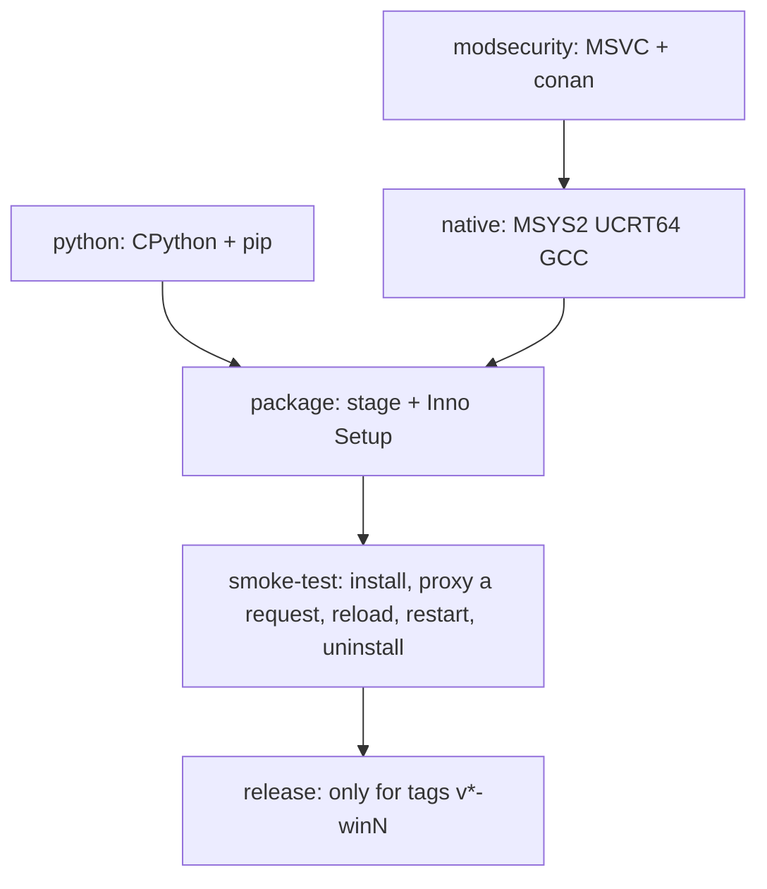

# BunkerWeb for Windows (unofficial native port)

This directory contains everything needed to build [BunkerWeb](https://github.com/bunkerity/bunkerweb) as a
**native Windows application**. It runs as Windows services, without containers, VMs or WSL.

The BunkerWeb sources are included as the git submodule [`../bunkerweb`](../bunkerweb). **The submodule is never modified.**
Every build copies `bunkerweb/src` and applies the Windows changes to the copy. The GitHub Actions
workflow [`.github/workflows/bunkerweb-windows.yml`](../.github/workflows/bunkerweb-windows.yml)
produces an Inno Setup installer `bunkerweb-<version>-win<N>-x64-setup.exe`.

> **Status:** experimental and unofficial. Bunkerity does not support it. The CI smoke test is meant to install
> the build on a clean Windows Server 2022 runner and proxy a request through it, but this is
> not a substitute for the upstream test suite. The pipeline was still being brought up when this was written, see
> [`../AGENTS.md`](../AGENTS.md#current-state). Validate your own use case before relying on it.

The operator documentation (installation, reverse proxy, Let's Encrypt) is in
[`../README.md`](../README.md). Contributors and coding agents: read [`../AGENTS.md`](../AGENTS.md) first.

---

## How the port works

BunkerWeb consists of:

- **nginx** with OpenResty's Lua modules plus a large amount of Lua code;
- a Python **scheduler** that generates the nginx configuration and runs jobs (Let's Encrypt, blacklists, ...);
- a Flask **web UI**;
- a FastAPI **API**.

All of it is written for Linux. The port keeps BunkerWeb's own code and Linux layout and bridges the gaps:

| Linux | Windows port |
|---|---|
| `/usr/share/bunkerweb`, `/etc/bunkerweb`, `/var/lib/bunkerweb`, ... | Everything lives under one root, `C:\bunkerweb\`, keeping the Linux sub-layout: `C:\bunkerweb\usr\share\bunkerweb`, `C:\bunkerweb\etc\bunkerweb`, `C:\bunkerweb\var\lib\bunkerweb`, ... At build time BunkerWeb's own POSIX paths are rewritten to `/bunkerweb/usr/share/bunkerweb`, `/bunkerweb/etc/bunkerweb`, ... (see below). Windows resolves such drive-less rooted paths against the current drive, and every service runs with working directory `C:\bunkerweb` (on `C:`), so they land in `C:\bunkerweb\...`. Nothing is installed in `C:\usr`, `C:\etc` or `C:\var`. |
| nginx + dynamic modules (OpenResty components) | `nginx.exe` built with MSYS2/GCC (UCRT). All modules are linked **statically**: lua, stream-lua, ndk, lua-upstream, headers-more, cookie-flag, brotli, ModSecurity-nginx. |
| OpenSSL as a shared library used through LuaJIT FFI | OpenSSL is linked into `nginx.exe` (whole archive) and exported, so `ffi.C` finds `SSL_*` / `EVP_*`, as `lua-resty-openssl` expects. |
| libmodsecurity.so | `libModSecurity.dll` built with MSVC 2022 using ModSecurity's own `build/win32` (conan). nginx links it through the plain C API (`msc_*`). |
| `ffi.load("libz.so")`, `package.cpath` `*.so` | `wincompat.lua` translates library names and paths. The Lua C modules are real DLLs that keep their `.so` names. |
| `ffi.C.inet_pton/ntohl/setenv/environ/fopen/flock/...` (libc functions Windows' `ffi.C` does not see) | `winffi.lua`: `wincompat.lua` installs an `ffi` proxy as `package.loaded["ffi"]`, so every Lua library required afterwards resolves these through ws2_32, the UCRT or a small `flock`/`fopen` emulation. No call site is patched. |
| `io.open(f, "w")` of binary data | `wincompat.lua` adds `b` to every writing mode (text mode would turn `0x0A` into `0x0D 0x0A` and corrupt uploaded archives). |
| `/proc/uptime` (Lua) | served by `wincompat.lua`'s `io.open` from `GetTickCount64` (Python side: patch `sync-tree-...`). |
| `io.popen` / `os.execute` of shell commands | `wincompat.lua` runs them through `busybox sh` (busybox-w32). |
| `kill -HUP <nginx>` (reload), `resty.signal`, `ngx.process.get_master_pid` | nginx for Windows signals through named events `Global\ngx_<signal>_<pid>`. `wincompat.lua` replaces `resty.signal` and `get_master_pid` at runtime; `bwsvc.py` uses the events too. |
| POSIX bits in Python (`fcntl`, `pwd`, `grp`, `os.getuid`, `os.kill(pid, 0)`, `SIGHUP`, ...) | `python-site/` shims, loaded through `sitecustomize`. |
| `Path("/x").is_absolute()` (BunkerWeb's rooted paths without drive, False on Windows since Python 3.13) | `sitecustomize.py` restores the pre-3.13 `ntpath.isabs` (a leading slash counts as absolute); the certbot entry point undoes it. |
| systemd units + `start.sh` / `bunkerweb-scheduler.sh` / `bunkerweb-ui.sh` / `bunkerweb-api.sh` | `share/windows/bwsvc.py`, a Python port of those scripts, started by [WinSW](https://github.com/winsw/winsw) services. |
| gunicorn | waitress (web UI) and uvicorn (API). |
| `systemctl reload bunkerweb-scheduler` | `bwctl reload-scheduler`, which uses a named event (ACL: SYSTEM and Administrators) and is mapped to the scheduler's SIGHUP handler. |
| Config generator's libssl probe for `ssl_ecdh_curve` (`find_library("ssl")`, `libssl.so.*`) | Loads the shipped `usr\sbin\libssl-3-x64.dll` (patch `templator-load-the-shipped-libssl-...`). |
| `DNS_RESOLVERS` default `127.0.0.11` (Docker's DNS) | Public resolvers (one-line replacement in `apply-windows-port.py`, step 3b). |
| `os.replace` over a live generated file | Retried for up to 20 s on `PermissionError` (patch `sync-tree-retry-replacing-...`), because Windows refuses to replace files that another process has open. |

The port is deliberately **layered**, from the most robust against upstream changes to the most fragile
(details and the ledger of every patch: [`patches/README.md`](patches/README.md)):

1. **Runtime shims** (`overlay/`): `wincompat.lua` + `winffi.lua` for Lua (ffi proxy, binary `io.open`, `resty.signal`,
   `get_master_pid`, `/proc/uptime`, busybox `popen`/`execute`) and `python-site/` for Python (POSIX modules,
   `subprocess`, `ntpath.isabs`). Nothing in BunkerWeb's sources is touched for these.
2. **Patch series** (`patches/*.patch`, git format-patch files): the multi-line changes with context. Seven patches:
   HTTP/3 off, the `HEALTHCHECK_PORT` setting, the uptime in `sync_tree.py`, nginx's `configure` on win32, the
   ModSecurity-nginx `dd()` macro, `free()` in lua-resty-core's shdict, the Templator without `fork`. Every patch states
   why it exists, its upstream status and how to tell it is obsolete.
3. **One-line replacements** in [`build/apply-windows-port.py`](build/apply-windows-port.py) (anchored and counted): no
   `load_module` lines, the `select` event model, no `reuseport`, `os.uname()` in `nginx.conf`, the early error log
   path for `nginx -t`, `require "bunkerweb.wincompat"` in `init_by_lua`, the `PYTHONPATH` separator and the hook
   invocation of Let's Encrypt.
4. **The installation root** ([`build/pathrewrite.py`](build/pathrewrite.py)): every BunkerWeb-owned absolute path
   (`/etc/bunkerweb`, `/etc/nginx`, `/usr/share/bunkerweb`, `/var/{cache,tmp,lib,log,run}/bunkerweb`, `/tmp/bunkerweb`,
   `/var/www/html`) in `.py`, `.lua`, `.conf`, `.json`, `.modsec` files (and `.sh` helpers of the core plugins) is
   rewritten to the same path below `/bunkerweb`, including paths Python builds from parts
   (`join(sep, "usr", "share", ...)`). System paths (`/dev/null`, `/usr/bin/env`, ...) are left alone. The step lists
   every Linux path it deliberately skipped as a `NOTE`, and fails if key files were not rewritten. Files from
   `overlay/` are not rewritten, they already contain the final paths.

The ModSecurity CMake trim lives in [`build/patch-modsecurity.py`](build/patch-modsecurity.py), so the 20 minute
`modsecurity` build is only invalidated by changes that affect it. Overlay files must not replace upstream files: a
collision fails the build (`OVERLAY_OVERRIDES` in `apply-windows-port.py` lists deliberate exceptions, none today).

All ports of the port can be chosen in `variables.env`: `HTTP_PORT`, `HTTPS_PORT`, `API_HTTP_PORT` and
`HEALTHCHECK_PORT` (the health check port, hardcoded `127.0.0.1:6000` upstream; `bwsvc.py` and `bwctl.py` read the same
keys), and the web UI port, which is the port of `UI_HOST` (`bwsvc.py`; `UI_LISTEN_PORT`/`LISTEN_PORT` in `ui.env`
override it).

When upstream changes, the build fails loudly instead of producing a silently broken package: a patch that no longer
applies, a replacement whose anchor count changed, or a key file the path rewrite no longer reaches. The failure lists
everything at once.

### Fast checks without Windows

`bash windows/build/port-check.sh` (CI: [`port-check.yml`](../.github/workflows/port-check.yml), every push and nightly
against the newest BunkerWeb release, which opens an issue when the port no longer applies) needs only git and Python:

| Check | Script | Finds |
|---|---|---|
| unit tests | `build/test-port.py` (+ `test-winffi.lua`) | regressions in the path rewrite (golden cases), the `isabs` shim, the Lua ffi proxy (fake ffi in LuaJIT through `lupa`), the patch lint |
| patch series lint | `build/patchtool.py lint` | patches without reason / `Upstream:` / `Check:` lines |
| apply the port | `build/apply-windows-port.py` | stale patches and anchors, overlay collisions |
| static checks | `build/check-port.py` | every changed file still compiles (Python), parses (LuaJIT, Jinja2, JSON); `wincompat` is first in `init_by_lua`; no `reuseport` left |
| hazard scan | `build/scan-hazards.py` | new Linux-isms (libc symbols, shell commands, native libraries, `fork`, signals, ...) compared with `build/hazards.baseline.txt` |

None of this proves that the port *runs*: the smoke test of the main pipeline still does that.


### Directory layout

```
windows/
  build/
    apply-windows-port.py     patch a copy of bunkerweb/src: overlay, patch series, anchored one-line replacements, path rewrite
    pathrewrite.py            the /etc/bunkerweb -> /bunkerweb/etc/bunkerweb rewrite (import-safe, golden-tested)
    patchseries.py            lint + apply of the patch series (git apply, no fuzz)
    patchtool.py              import / export / lint of windows/patches (scratch git repo, 3-way rebase onto a new upstream)
    patch-modsecurity.py      the ModSecurity part of the patch (split off so the modsecurity build cache ignores the rest)
    port-check.sh             the fast checks below, in one command
    test-port.py, test-winffi.lua   unit tests (path rewrite, isabs shim, Lua ffi proxy)
    check-port.py             syntax checks of every file the port changed
    scan-hazards.py, hazards.baseline.txt   new Linux-isms in upstream code, compared with a reviewed baseline
    build-modsecurity.ps1     libModSecurity.dll (MSVC 2022 + conan + CMake)
    build-native.sh           nginx.exe, LuaJIT, cjson/gd, Lua libraries, runtime DLLs (MSYS2 UCRT64)
    build-python.ps1          private CPython + BunkerWeb requirements (+ certbot DNS alias patch)
    prepare-requirements.py   merges BunkerWeb's hashed requirement files (drops uvloop)
    stage.ps1                 assembles the tree that mirrors C:\bunkerweb\
  installer/bunkerweb.iss     Inno Setup 6 script
  patches/                    the patch series (*.patch, .patches, BASE) and its ledger (README.md)
  overlay/
    src/bw/lua/bunkerweb/wincompat.lua     Lua compatibility layer (copied into the patched sources)
    src/bw/lua/bunkerweb/winffi.lua        the ffi proxy wincompat.lua installs (libc/winsock/UCRT lookups)
    python-site/                           sitecustomize.py, fcntl.py, pwd.py, grp.py
    share/windows/bwsvc.py                 service runner (nginx, scheduler, ui, api)
    share/windows/bwctl.py                 operator helper (status, reload, logs, ...)
    share/deps/python/bin/certbot          certbot entry point
    bin/bwctl.cmd, bin/bwcli.cmd           command wrappers (C:\bunkerweb\usr\bin is added to PATH)
  service/bunkerweb-*.xml     WinSW service definitions
```

### Installed layout

```
C:\bunkerweb\usr\share\bunkerweb\        BunkerWeb (same layout as the Linux packages) + python\ + windows\ + service\
C:\bunkerweb\usr\sbin\                   nginx.exe, lua51.dll, libModSecurity.dll, OpenSSL/PCRE2/... DLLs
C:\bunkerweb\usr\bin\                    busybox.exe, sh.exe, openssl.exe, sqlite3.exe, luajit.exe, bwctl.cmd, bwcli.cmd
C:\bunkerweb\etc\bunkerweb\              variables.env, scheduler.env, ui.env, api.env, configs\, plugins\   (kept)
C:\bunkerweb\etc\nginx\                  generated nginx configuration
C:\bunkerweb\var\lib\bunkerweb\          db.sqlite3, backups, job data                                      (kept)
C:\bunkerweb\var\cache\bunkerweb\        job cache, Let's Encrypt certificates                               (kept)
C:\bunkerweb\var\log\bunkerweb\          error.log, access.log, scheduler.log, ui.log, service\*.log        (kept)
```

The only things outside `C:\bunkerweb\` are the Windows service registrations, the PATH entry, the firewall rules and the
uninstaller (`%ProgramData%\BunkerWeb\uninstall`).

Windows services:

| Service | Start type | Purpose |
|---|---|---|
| `bunkerweb-nginx` | Automatic | nginx master process (`start.sh` equivalent) |
| `bunkerweb-scheduler` | Automatic (delayed) | configuration generation and jobs (Let's Encrypt, ...) |
| `bunkerweb-ui` | Automatic (delayed) / Disabled | web UI on `127.0.0.1`, port 7000 (the port of `UI_HOST`) |
| `bunkerweb-api` | Manual | optional REST API on `127.0.0.1:8888` |

---

## Building

### On GitHub Actions (normal way)

The workflow runs on `windows-2022` runners:



The smoke test assumes no port number: it picks free TCP ports at run time (random, 20000-29999, test-bound first) for
HTTP, HTTPS, the web UI, the internal API, the health check and the test backend, writes them into `variables.env`, and
checks that the firewall rule, the listeners and the proxied requests use exactly those.

**Triggers:**
- `workflow_dispatch`, where you can set the port revision;
- pushes to `main` that touch `windows/**`, the submodule pointer or the workflow;
- pull requests that touch the same paths;
- tags.

**Artifacts:**
- `installer`: the setup exe and `SHA256SUMS.txt`;
- `stage`: the staged tree, useful to inspect a build;
- `smoke-test-logs`: BunkerWeb logs and the generated nginx configuration from the test install.

**Releases:** push a tag `v<bunkerweb-version>-win<N>`, for example `v1.6.17-win1`. The tag must match
`bunkerweb/src/VERSION`. The release is only published when the smoke test passes.

The first ModSecurity build compiles its conan dependencies (Poco, libcurl, libxml2, ...) and can take
a long time. They are cached afterwards.

**Build caches:** the three build jobs (`modsecurity`, `native`, `python`) and `package` (the finished installer) cache their output. The cache key is made of the
commit of the `bunkerweb` submodule, the files of this repository that influence that output (port script, build scripts, overlay
files) and `CACHE_VERSION` in the workflow. A run on an unchanged source restores the output instead of rebuilding it, which
turns a repeated run into a few minutes (package + smoke test). Changing the submodule or one of those files rebuilds only the
affected jobs. The caches are saved right after a successful build, so a failing `smoke-test` can be repeated on the same
commit without rebuilding anything. On an installer cache hit the `stage` artifact is not produced. The workflow file itself is
not part of the keys: bump `CACHE_VERSION` to force a full rebuild or after changing how a job builds. Release tags carry their own
port revision, so they rebuild the installer but reuse the `native` and `python` caches. Caches that were not used for 7 days are
evicted by GitHub.

### Locally

There is no supported local build. You can reproduce it on a Windows machine with:

- Visual Studio 2022 Build Tools;
- CMake;
- conan 2;
- MSYS2 with the UCRT64 packages listed in the workflow;
- Python 3.14;
- Inno Setup 6.

Run the same steps as the workflow, in this order:

1. `prepare-src`;
2. `build-modsecurity.ps1`;
3. `build-native.sh` in the UCRT64 shell;
4. `build-python.ps1`;
5. `stage.ps1`;
6. `ISCC`.

---

## Upgrading BunkerWeb

The nightly [`port-check`](../.github/workflows/port-check.yml) already tries the newest upstream release and opens an
issue labelled `upstream-update` when the port no longer applies, so the work usually starts before you look.

1. Move the submodule to the new release tag:
   ```sh
   git -C bunkerweb fetch --tags
   git -C bunkerweb checkout v1.6.18
   git add bunkerweb
   ```
2. Move the patch series with git's 3-way merge (nothing is written to `bunkerweb/`):
   ```sh
   python windows/build/patchtool.py import --force --rev v1.6.18
   #   conflict: resolve in build/patchwork, `git add`, `git rebase --continue`
   python windows/build/patchtool.py export
   ```
   Drop a patch whose `Check:` line says upstream has fixed the problem (`git rebase -i` in the scratch repo).
3. Run `bash windows/build/port-check.sh` (needs `pip install lupa jinja2`). Fix what it reports, in this order of
   preference: a shim in `overlay/`, a pattern in `pathrewrite.py`, a patch, a one-line replacement in
   `apply-windows-port.py`.
4. Read the **hazard scan** report: every new line is something upstream now does that nobody has looked at on Windows
   (a new libc function, shell command, native library, `fork`, signal, text-mode write, ...). Decide whether it needs
   a shim or patch; then refresh the baseline with `python windows/build/scan-hazards.py build/src --update` and commit it with the
   fix.
5. Push and let the main workflow run (it is the only place that runs the port): the smoke test decides.

Things that usually need attention on upgrades, which no Linux-side check can see:

- new dependencies in `src/deps/deps.json` (nginx modules or Lua libraries in `build-native.sh`);
- new Python requirements without Windows wheels;
- changes of how nginx is started, reloaded or health-checked.

---

## Known limitations

- **Single nginx worker, `select()` event model.** nginx for Windows does not scale like nginx on Linux. Each worker
  is limited to about 4096 sockets (`FD_SETSIZE=4096` at build time). That is plenty for a typical on-premise
  reverse proxy, but not for high-traffic sites.
- **No HTTP/3 / QUIC**, no `reuseport`. nginx has no `http_v3_module` here, so the `http3` directive, `listen ... quic` and `$http3` are unknown: the patch `switch-http-3-quic-off-for-good` disables the templates' HTTP/3 blocks and gives the limiter an empty HTTP/3 key.
- **Not built:** luasocket, luasec and `lua-resty-signal`. BunkerWeb's core plugins do not need them, but third-party
  plugins might.
- **ModSecurity** is built from the vendored v3 sources with MSVC. The OWASP CRS is included. Performance on
  Windows has not been profiled.
- **Paths are fixed to `C:\bunkerweb`** (drive `C:`). Paths you write yourself (in `variables.env`, custom configs, plugins)
  must use `C:/bunkerweb/...` or `/bunkerweb/...`: only BunkerWeb's built-in defaults are rewritten at build time.
- **External plugins** that execute Linux binaries or shell scripts will not work unless busybox provides the tool.
- **Unofficial:** do not open issues at bunkerity/bunkerweb for problems of this port.

## Licence

BunkerWeb is licensed under the **GNU Affero General Public License v3.0** (see
[`../bunkerweb/LICENSE.md`](../bunkerweb/LICENSE.md)). The Windows port is a modified version of BunkerWeb and is
distributed under the same licence.

If you distribute the installer, or let users interact with a modified BunkerWeb over a network, you must offer
the **complete corresponding source**. That source is this repository, including `windows/` and the
workflow, at the commit or tag the installer was built from, together with the referenced `bunkerweb`
submodule commit.

Keep this repository public, or provide the source in another way, whenever you distribute builds.

Bundled third-party components keep their own licences, including:

- nginx (BSD-2);
- LuaJIT (MIT);
- OpenSSL (Apache-2.0);
- ModSecurity (Apache-2.0);
- CPython (PSF);
- busybox-w32 (GPLv2);
- WinSW (MIT);
- the MSYS2/MinGW runtime libraries (various).
